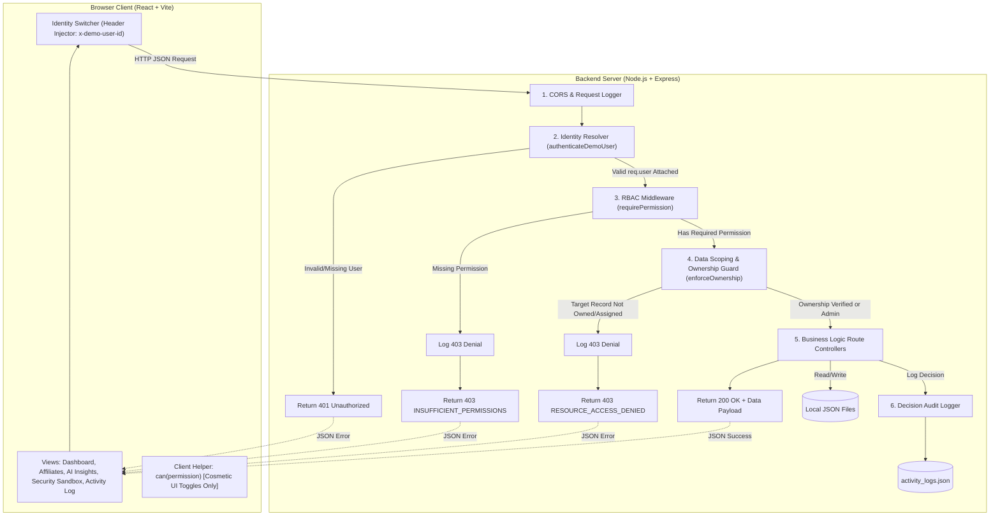
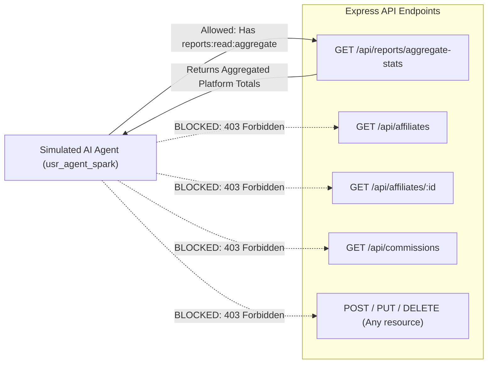

# System Architecture & Technical Design

**Project:** Affiliate Access Lab — RBAC and Least-Privilege Prototype  
**Phase:** Phase 3 — Design  
**Status:** Ready for Review & Approval  

---

## 1. High-Level System Architecture

The Affiliate Access Lab follows a decoupled, client-server architecture. All security decisions are strictly executed on the server. The client UI is purely a presentation layer that reflects the state and permissions granted by the server.



---

## 2. End-to-End Request Lifecycle Explained

Every incoming HTTP request traverses a 6-stage security pipeline:

### Step 1: Request Ingestion & Logging
The request arrives at Express. Standard middleware parses the JSON body and extracts request metadata (timestamp, HTTP verb, route path).

### Step 2: Simulated Identity Resolution (`authenticateDemoUser`)
- The middleware reads the `x-demo-user-id` header (e.g., `usr_mgr_sarah`).
- It looks up the user in `users.json`.
- If the header is missing or the ID is unrecognized, the server responds immediately with `401 Unauthorized` (`MISSING_OR_INVALID_IDENTITY`).
- If valid, it hydrates `req.user` with the user's ID, name, role, and assigned permissions (resolved from `roles.json`).

> **Security Note:** In a real production system, this step would verify a cryptographically signed JSON Web Token (JWT) or decrypt a secure session cookie. Here, it looks up local demo identities to enable rapid, passwordless role switching during evaluation.

### Step 3: RBAC Permission Enforcement (`requirePermission(perm)`)
- The endpoint declares its required permission (e.g., `requirePermission('affiliates:create')`).
- The middleware checks if `req.user.permissions` contains the required permission string.
- If missing, the request is terminated with `403 Forbidden` (`INSUFFICIENT_PERMISSIONS`).
- An entry is immediately recorded in the in-app Activity Log noting the denied attempt.

### Step 4: Data Scoping & Ownership Enforcement (`enforceOwnership(resourceType)`)
- Having the role permission alone is not enough. If the request targets a specific resource (e.g., `GET /api/affiliates/aff_bob`), this middleware loads the target record.
- **Admin:** Bypasses ownership checks (`req.user.role === 'admin'`).
- **Affiliate Manager:** Ensures `affiliate.assignedManagerId === req.user.id`.
- **Affiliate User:** Ensures `affiliate.userId === req.user.id`.
- If the scoping condition fails, the request is terminated with `403 Forbidden` (`RESOURCE_ACCESS_DENIED`).

### Step 5: Route Controller Execution
The controller runs business logic safely, knowing that identity, permissions, and data ownership have all been verified. It performs reads or mutations against the local JSON storage.

### Step 6: Decision Auditing & Standardized Response
The controller logs the successful action (`200 OK`) to `activity_logs.json` and returns the sanitized payload to the client.

---

## 3. Data Storage & Local JSON Schema Design

All application data is stored in human-readable JSON files located in `/backend/data/`:

```
backend/
└── data/
    ├── users.json          # Demo identities & credentials reference
    ├── roles.json          # Role definitions & permission arrays
    ├── affiliates.json     # Affiliate partner records & assignments
    ├── commissions.json    # Transaction records & payout statuses
    └── activity_logs.json  # Runtime audit trail of access decisions
```

### 3.1 `roles.json`
Defines the authoritative role-to-permission mapping:
```json
{
  "admin": {
    "name": "Administrator",
    "description": "Full administrative system access",
    "permissions": [
      "affiliates:read:all",
      "affiliates:create",
      "affiliates:update:all",
      "affiliates:delete",
      "commissions:read:all",
      "commissions:approve",
      "reports:read:aggregate",
      "activity:read"
    ]
  },
  "affiliate_manager": {
    "name": "Affiliate Manager",
    "description": "Manages assigned portfolio of affiliates",
    "permissions": [
      "affiliates:read:assigned",
      "affiliates:update:assigned",
      "commissions:read:assigned",
      "reports:read:aggregate",
      "activity:read"
    ]
  },
  "affiliate_user": {
    "name": "Affiliate Partner",
    "description": "Individual publisher with personal dashboard",
    "permissions": [
      "affiliates:read:own",
      "affiliates:update:own",
      "commissions:read:own"
    ]
  },
  "ai_agent": {
    "name": "Simulated AI Agent",
    "description": "Automated analytics worker under strict least-privilege",
    "permissions": [
      "reports:read:aggregate"
    ]
  }
}
```

### 3.2 `users.json`
Represents the available demo identities:
```json
[
  {
    "id": "usr_admin_alex",
    "name": "Alex Carter",
    "email": "alex.carter@platform.local",
    "role": "admin",
    "avatar": "admin-avatar.svg"
  },
  {
    "id": "usr_mgr_sarah",
    "name": "Sarah Jenkins",
    "email": "sarah.jenkins@platform.local",
    "role": "affiliate_manager",
    "avatar": "manager-sarah.svg"
  },
  {
    "id": "usr_mgr_david",
    "name": "David Kim",
    "email": "david.kim@platform.local",
    "role": "affiliate_manager",
    "avatar": "manager-david.svg"
  },
  {
    "id": "usr_aff_alice",
    "name": "Alice Rivera",
    "email": "alice@techreviews.com",
    "role": "affiliate_user",
    "avatar": "affiliate-alice.svg"
  },
  {
    "id": "usr_aff_bob",
    "name": "Bob Chen",
    "email": "bob@fitnessgear.io",
    "role": "affiliate_user",
    "avatar": "affiliate-bob.svg"
  },
  {
    "id": "usr_agent_spark",
    "name": "MarketPulse AI Agent",
    "email": "agent.marketpulse@system.internal",
    "role": "ai_agent",
    "avatar": "bot-avatar.svg"
  }
]
```

### 3.3 `affiliates.json`
Stores affiliate profiles, tracking keys, assigned managers, and ownership links:
```json
[
  {
    "id": "aff_alice",
    "userId": "usr_aff_alice",
    "name": "Alice Rivera",
    "website": "https://techreviews.com",
    "assignedManagerId": "usr_mgr_sarah",
    "status": "active",
    "commissionRate": 15.0,
    "referralCode": "ALICE-TECH-2026",
    "metrics": {
      "totalClicks": 14200,
      "totalConversions": 850,
      "totalEarnings": 12750.00
    },
    "internalNotes": "Top tech influencer. High conversion on SaaS promotions."
  },
  {
    "id": "aff_bob",
    "userId": "usr_aff_bob",
    "name": "Bob Chen",
    "website": "https://fitnessgear.io",
    "assignedManagerId": "usr_mgr_sarah",
    "status": "active",
    "commissionRate": 12.5,
    "referralCode": "BOB-FIT-2026",
    "metrics": {
      "totalClicks": 9100,
      "totalConversions": 420,
      "totalEarnings": 5250.00
    },
    "internalNotes": "Fitness vertical. Preparing Q2 protein powder campaign."
  },
  {
    "id": "aff_charlie",
    "userId": "usr_aff_charlie",
    "name": "Charlie Gomez",
    "website": "https://lifestylehub.blog",
    "assignedManagerId": "usr_mgr_david",
    "status": "pending_review",
    "commissionRate": 10.0,
    "referralCode": "CHARLIE-LIFE-2026",
    "metrics": {
      "totalClicks": 2100,
      "totalConversions": 95,
      "totalEarnings": 950.00
    },
    "internalNotes": "Assigned to David Kim. Pending identity document verification."
  }
]
```

### 3.4 `commissions.json`
Stores individual transaction payouts:
```json
[
  {
    "id": "comm_101",
    "affiliateId": "aff_alice",
    "userId": "usr_aff_alice",
    "assignedManagerId": "usr_mgr_sarah",
    "amount": 2500.00,
    "period": "October 2026",
    "status": "paid",
    "approvedBy": "usr_admin_alex",
    "createdAt": "2026-11-01T09:00:00.000Z"
  },
  {
    "id": "comm_102",
    "affiliateId": "aff_bob",
    "userId": "usr_aff_bob",
    "assignedManagerId": "usr_mgr_sarah",
    "amount": 1100.00,
    "period": "October 2026",
    "status": "pending",
    "approvedBy": null,
    "createdAt": "2026-11-01T09:15:00.000Z"
  },
  {
    "id": "comm_103",
    "affiliateId": "aff_charlie",
    "userId": "usr_aff_charlie",
    "assignedManagerId": "usr_mgr_david",
    "amount": 350.00,
    "period": "October 2026",
    "status": "pending",
    "approvedBy": null,
    "createdAt": "2026-11-01T09:30:00.000Z"
  }
]
```

### 3.5 `activity_logs.json`
Maintains the runtime decision audit trail:
```json
[
  {
    "id": "act_001",
    "timestamp": "2026-11-03T12:00:00.000Z",
    "userId": "usr_aff_alice",
    "userRole": "affiliate_user",
    "method": "GET",
    "path": "/api/affiliates",
    "requiredPermission": "affiliates:read:own",
    "outcome": "ALLOWED",
    "statusCode": 200,
    "details": "Returned 1 personal record"
  },
  {
    "id": "act_002",
    "timestamp": "2026-11-03T12:01:15.000Z",
    "userId": "usr_aff_alice",
    "userRole": "affiliate_user",
    "method": "DELETE",
    "path": "/api/affiliates/aff_bob",
    "requiredPermission": "affiliates:delete",
    "outcome": "DENIED",
    "statusCode": 403,
    "details": "Missing permission: affiliates:delete"
  }
]
```

---

## 4. AI Agent Least-Privilege Architecture

The prototype treats the **Simulated AI Agent** as an authentic software actor subject to strict security boundaries:



### How Least Privilege is Enforced for the AI Agent:
1. **Explicit Whitelist of Permissions:**
   The role `ai_agent` has only one entry in `roles.json`: `reports:read:aggregate`.
2. **Zero PII Exposure:**
   The aggregate endpoint (`/api/reports/aggregate-stats`) computes statistical metrics mathematically across records:
   - `totalActiveAffiliates: 3`
   - `totalPlatformConversions: 1365`
   - `overallConversionRate: 5.37%`
   - `topPerformingCategory: "Tech & Consumer Electronics"`
   It **strips away** all names, email addresses, personal IDs, and bank account details before returning data.
3. **Immutability Protection:**
   The AI agent cannot execute any mutating HTTP method (`POST`, `PUT`, `DELETE`). If an automated tool tries to alter commission terms or delete users, the backend immediately issues a `403 Forbidden`.
4. **Transparent Simulated Summary:**
   The frontend displays the agent's summary clearly marked as: *"Generated by Local Simulated Analytics Engine using aggregated, privacy-preserving data."* No external LLM credentials or third-party connections are used.

---

## 5. Security Architecture & Boundary Summary

| Threat / Risk | Mitigation Mechanism in Prototype | File / Layer Responsible |
| :--- | :--- | :--- |
| **Tampered / Spoofed Role in Browser** | The client only sends `x-demo-user-id`. The server resolves the role and permissions from its local `users.json` and `roles.json`. Any client claim of role is disregarded. | `/backend/middleware/auth.js` |
| **Unauthorized Action (Missing Verb)** | The route declares its required permission. Middleware blocks execution with `403 Forbidden` if the user's role lacks that permission. | `/backend/middleware/rbac.js` |
| **Cross-Tenant Access (BOLA / IDOR)** | After passing the permission check, the server inspects resource ownership (`userId` or `assignedManagerId`). Rejects with `403 Forbidden` if unassigned. | `/backend/middleware/ownership.js` |
| **Over-Privileged AI Bot** | The AI agent has zero read access to raw PII and zero write access to any endpoint. Only pre-aggregated stats are exposed. | `/backend/routes/reports.js` |
| **Information Leakage in Errors** | Denied responses return structured, sanitized JSON error payloads without stack traces or internal filesystem paths. | `/backend/middleware/errorHandler.js` |

