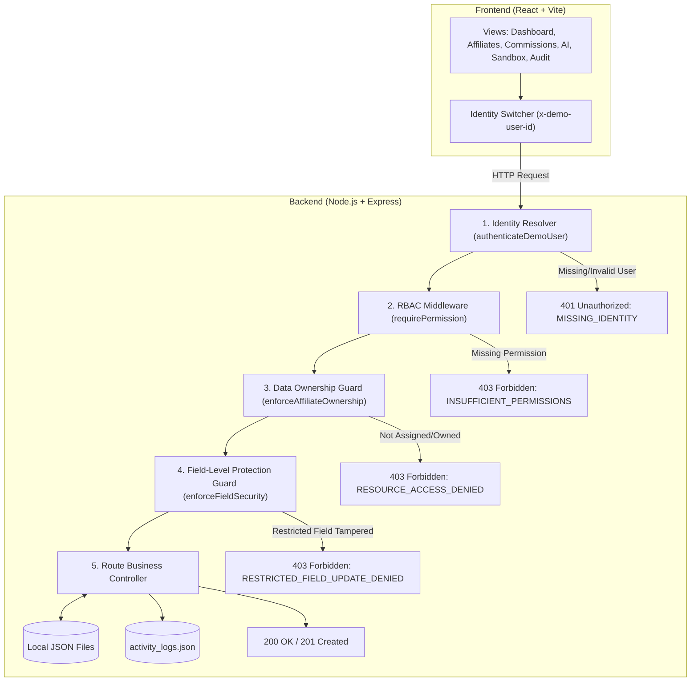

# Affiliate Access Lab — Complete Master Project Documentation
**System:** Role-Based Access Control (RBAC) & Least-Privilege Prototype  
**Technology Stack:** React (Vite) + Node.js (Express) + Local JSON Storage  
**Location:** `E:\HARSHITHA\OTTOBON\affiliate-access-lab`  

---

# Table of Contents
1. [Executive Summary & Problem Statement](#1-executive-summary--problem-statement)
2. [Foundational Security Concepts](#2-foundational-security-concepts)
3. [User Personas & Role Responsibilities](#3-user-personas--role-responsibilities)
4. [Functional Requirements (FR)](#4-functional-requirements-fr)
5. [Non-Functional Requirements (NFR)](#5-non-functional-requirements-nfr)
6. [Role-Based Access Control (RBAC) Matrix](#6-role-based-access-control-rbac-matrix)
7. [System Architecture & Request Lifecycle](#7-system-architecture--request-lifecycle)
8. [Data Schema & Local JSON Storage](#8-data-schema--local-json-storage)
9. [REST API Specification](#9-rest-api-specification)
10. [UI/UX Layout & Component Design](#10-uiux-layout--component-design)
11. [Simulated AI Agent Least-Privilege Design](#11-simulated-ai-agent-least-privilege-design)
12. [Testing Strategy & Test Matrix](#12-testing-strategy--test-matrix)
13. [Verification & Demonstration Script](#13-verification--demonstration-script)
14. [Prototype Limitations vs. Production Architecture](#14-prototype-limitations-vs-production-architecture)

---

# 1. Executive Summary & Problem Statement

### 1.1 The Problem
In affiliate marketing platforms, sensitive commercial data—including affiliate commissions, conversion rates, payout bank ledgers, referral codes, and partner contact information—is accessed by multiple parties: platform administrators, partner managers, publisher affiliates, and automated analytics agents.

Without rigorous server-enforced access controls:
- **Data Leakage (BOLA / IDOR):** An affiliate can access a competitor's earnings or contact details simply by altering record IDs in query parameters or HTTP requests.
- **Privilege Escalation:** A partner manager or affiliate can call administrative endpoints to create accounts, approve payouts, or modify commission tiers.
- **Over-Privileged AI Agents:** Automated bots granted broad read access inadvertently ingest and leak Personally Identifiable Information (PII).
- **Client-Side Obscurity Fallacy:** Developers mistakenly treat hiding buttons in React as security, leaving backend APIs open to direct `curl`, Postman, or script execution.

### 1.2 The Solution
The **Affiliate Access Lab** prototype demonstrates how modern, secure web applications solve these risks through **server-enforced Role-Based Access Control (RBAC)**, **Least Privilege**, and **Data Ownership checks**. Every protected action and record is validated on the server regardless of client state.

---

# 2. Foundational Security Concepts

| Concept | Plain English Definition | Real-World Affiliate Portal Analogy |
| :--- | :--- | :--- |
| **Authentication (AuthN)** | Verifying **WHO** you are (Identity verification). | Presenting your ID badge to prove you are Alice. |
| **Authorization (AuthZ)** | Determining **WHAT** you are allowed to do. | Verifying if Alice's badge permits entry into the payout approval vault. |
| **RBAC (Role-Based Access Control)** | Grouping permissions into roles, then assigning roles to identities. | Assigning Alice the role "Affiliate Manager" so she inherits manager permissions. |
| **Least Privilege (PoLP)** | Granting an actor **only** the minimum access needed for its specific task. | An analytical bot can read platform aggregate numbers, but is blocked from names, emails, and write actions. |
| **Data Ownership & Scoping** | Determining **WHICH SPECIFIC RECORDS** a permitted role may access. | Alice and Bob both have the role "Affiliate", but Alice can read *only her own* earnings, never Bob's. |

---

# 3. User Personas & Role Responsibilities

### 3.1 Admin (`admin`) — *Alex Carter (`usr_admin_alex`)*
- **Profile:** System executive administrator.
- **Responsibilities:**
  - Full platform visibility across all affiliate accounts, managers, and financial records.
  - Onboard new affiliates and assign them to managers.
  - Update any affiliate profile, commission rate, or account status.
  - Approve pending commission payout batches.
  - View real-time security decision audit streams.
- **Scope:** **Global (All platform records).**

### 3.2 Affiliate Manager (`affiliate_manager`) — *Sarah Jenkins (`usr_mgr_sarah`), David Kim (`usr_mgr_david`)*
- **Profile:** Regional partner manager responsible for a dedicated portfolio of affiliates.
- **Responsibilities:**
  - View performance and conversions *only* for affiliates explicitly assigned to them.
  - Update internal notes and review statuses for assigned affiliates.
  - Prohibited from accessing affiliates assigned to other managers.
  - Prohibited from modifying platform-wide commission rates or approving financial payouts.
- **Scope:** **Assigned Portfolio Only (`record.assignedManagerId === user.id`).**

### 3.3 Affiliate User (`affiliate_user`) — *Alice Rivera (`usr_aff_alice`), Bob Chen (`usr_aff_bob`)*
- **Profile:** Independent content publisher promoting products.
- **Responsibilities:**
  - View personal tracking links, conversion stats, and earned commission payouts.
  - Update personal website URL and profile preferences.
  - Prohibited from seeing any other affiliate's revenue, email, or performance metrics.
  - Prohibited from modifying their own commission percentage or assigned manager.
- **Scope:** **Own Record Only (`record.userId === user.id`).**

### 3.4 Simulated AI Agent (`ai_agent`) — *MarketPulse AI Agent (`usr_agent_spark`)*
- **Profile:** Autonomous background reporting service operating under least privilege.
- **Responsibilities:**
  - Query platform aggregate statistics (total clicks, conversions, average conversion efficiency).
  - Generate automated high-level performance trend summaries.
  - Strictly blocked from accessing individual partner records, names, emails, or bank accounts (Zero PII).
  - Strictly blocked from executing any write or mutation operations (`POST`, `PUT`, `DELETE`).
- **Scope:** **Aggregate Only (No individual records, Zero PII, Zero mutations).**

---

# 4. Functional Requirements (FR)

- **FR-1: Simulated Identity Switching:** The application provides a top bar dropdown to switch between active demo identities, injecting `x-demo-user-id` into API requests.
- **FR-2: Role-Aware Dashboard:** Dashboard displays user profile, granted permissions cloud, and role-tailored KPI cards.
- **FR-3: Scoped Affiliate Directory:** Listing affiliates automatically scopes records on the server (Admin: 3, Manager Sarah: 2, Affiliate Alice: 1, AI Agent: 0/Access Denied).
- **FR-4: Affiliate Profile Detail View:** Displays clicks, conversions, and notes; internal manager notes are sanitized by the server for affiliate users.
- **FR-5: Affiliate Creation & Deletion:** Creating and deleting affiliates is strictly restricted to Admins.
- **FR-6: Field-Level Protection:** Non-admins cannot alter `commissionRate`, `assignedManagerId`, or `status`. Any attempt is rejected with HTTP `403`.
- **FR-7: Financial Commission Ledgers:** Displays payout records filtered by data scope; payout approval action is restricted to Admins.
- **FR-8: Simulated AI Summary:** An automated summary generated from aggregate platform metrics, accompanied by a 0% PII exposure verification audit.
- **FR-9: Interactive Security Sandbox:** A "Tamper & Test" playground with one-click attack simulations (Privilege Escalation, IDOR, Boundary Violations, Field Tampering) executing real HTTP calls and showing live server responses.
- **FR-10: In-App Decision Audit Stream:** A real-time log capturing every `ALLOWED` and `DENIED` access decision with timestamps, actor IDs, endpoints, and reasons.

---

# 5. Non-Functional Requirements (NFR)

- **NFR-1: Server-Side Enforcement (Zero Trust):** The client's self-reported role or UI state is never trusted. All authorization, ownership, and field checks are executed on the server.
- **NFR-2: Architectural Separation:** Clean separation between the React frontend and Express backend communicating purely over JSON HTTP APIs.
- **NFR-3: Standardized Error Handling:** Standardized error codes returned on access denial (`INSUFFICIENT_PERMISSIONS`, `RESOURCE_ACCESS_DENIED`, `RESTRICTED_FIELD_UPDATE_DENIED`).
- **NFR-4: Information Leakage Prevention:** Errors and logs contain sanitized operational details without exposing database paths, internal tokens, or stack traces.
- **NFR-5: Self-Contained Local Persistence:** Pure local JSON storage in `backend/data/` with zero external databases or cloud dependencies.
- **NFR-6: Automated Test Verification:** Automated security tests asserting status codes (`200`, `201`, `401`, `403`) against running endpoints.

---

# 6. Role-Based Access Control (RBAC) Matrix

| Operation | HTTP Verb & Route | Required Permission | Admin | Manager | Affiliate | AI Agent | Data Scope Enforced | Denied Response Code |
| :--- | :---: | :--- | :---: | :---: | :---: | :---: | :--- | :--- |
| **List Affiliates** | `GET /api/affiliates` | `affiliates:read:*` | ✅ | ✅ | ✅ | ❌ | **Admin:** All<br>**Manager:** Assigned<br>**Affiliate:** Own<br>**AI:** None | `403 INSUFFICIENT_PERMISSIONS` |
| **Get Affiliate Detail** | `GET /api/affiliates/:id` | `affiliates:read:*` | ✅ | ✅ (Assigned) | ✅ (Own) | ❌ | **Manager:** `assignedManagerId === user.id`<br>**Affiliate:** `userId === user.id` | `403 RESOURCE_ACCESS_DENIED` |
| **Create Affiliate** | `POST /api/affiliates` | `affiliates:create` | ✅ | ❌ | ❌ | ❌ | **Admin:** Platform-wide | `403 INSUFFICIENT_PERMISSIONS` |
| **Update Profile** | `PUT /api/affiliates/:id` | `affiliates:update:*` | ✅ | ✅ (Assigned) | ✅ (Own) | ❌ | **Manager:** Notes only<br>**Affiliate:** Website only | `403 RESOURCE_ACCESS_DENIED` |
| **Modify Commission Rate** | `PUT /api/affiliates/:id` | `Field Protection` | ✅ | ❌ | ❌ | ❌ | **Admin:** Full rights | `403 RESTRICTED_FIELD_UPDATE_DENIED` |
| **Delete Affiliate** | `DELETE /api/affiliates/:id` | `affiliates:delete` | ✅ | ❌ | ❌ | ❌ | **Admin:** Platform-wide | `403 INSUFFICIENT_PERMISSIONS` |
| **View Commissions** | `GET /api/commissions` | `commissions:read:*` | ✅ | ✅ (Assigned) | ✅ (Own) | ❌ | Scoped to assigned portfolio or own user ID | `403 INSUFFICIENT_PERMISSIONS` |
| **Approve Payout** | `POST /api/commissions/:id/approve` | `commissions:approve` | ✅ | ❌ | ❌ | ❌ | **Admin:** Platform-wide | `403 INSUFFICIENT_PERMISSIONS` |
| **Query Aggregate Stats** | `GET /api/reports/aggregate-stats` | `reports:read:aggregate` | ✅ | ✅ | ❌ | ✅ | Mathematical platform totals (Zero PII) | `403 INSUFFICIENT_PERMISSIONS` |
| **View Decision Log** | `GET /api/activity` | `activity:read` | ✅ | ✅ | ❌ | ❌ | System decision audit trail | `403 INSUFFICIENT_PERMISSIONS` |

---

# 7. System Architecture & Request Lifecycle



---

# 8. Data Schema & Local JSON Storage

Data files are located in `/backend/data/`:

### 8.1 `roles.json`
```json
{
  "admin": {
    "name": "Administrator",
    "permissions": ["affiliates:read:all", "affiliates:create", "affiliates:update:all", "affiliates:delete", "commissions:read:all", "commissions:approve", "reports:read:aggregate", "activity:read"]
  },
  "affiliate_manager": {
    "name": "Affiliate Manager",
    "permissions": ["affiliates:read:assigned", "affiliates:update:assigned", "commissions:read:assigned", "reports:read:aggregate", "activity:read"]
  },
  "affiliate_user": {
    "name": "Affiliate Partner",
    "permissions": ["affiliates:read:own", "affiliates:update:own", "commissions:read:own"]
  },
  "ai_agent": {
    "name": "Simulated AI Agent",
    "permissions": ["reports:read:aggregate"]
  }
}
```

### 8.2 `users.json`
```json
[
  { "id": "usr_admin_alex", "name": "Alex Carter", "role": "admin" },
  { "id": "usr_mgr_sarah", "name": "Sarah Jenkins", "role": "affiliate_manager" },
  { "id": "usr_mgr_david", "name": "David Kim", "role": "affiliate_manager" },
  { "id": "usr_aff_alice", "name": "Alice Rivera", "role": "affiliate_user" },
  { "id": "usr_aff_bob", "name": "Bob Chen", "role": "affiliate_user" },
  { "id": "usr_agent_spark", "name": "MarketPulse AI Agent", "role": "ai_agent" }
]
```

### 8.3 `affiliates.json`
```json
[
  {
    "id": "aff_alice",
    "userId": "usr_aff_alice",
    "name": "Alice Rivera",
    "website": "https://techreviews.com",
    "assignedManagerId": "usr_mgr_sarah",
    "status": "active",
    "commissionRate": 15.0,
    "internalNotes": "Top tech influencer."
  },
  {
    "id": "aff_bob",
    "userId": "usr_aff_bob",
    "name": "Bob Chen",
    "website": "https://fitnessgear.io",
    "assignedManagerId": "usr_mgr_sarah",
    "status": "active",
    "commissionRate": 12.5,
    "internalNotes": "Fitness and nutrition specialist."
  },
  {
    "id": "aff_charlie",
    "userId": "usr_aff_charlie",
    "name": "Charlie Gomez",
    "website": "https://lifestylehub.blog",
    "assignedManagerId": "usr_mgr_david",
    "status": "pending_review",
    "commissionRate": 10.0,
    "internalNotes": "Assigned to David Kim."
  }
]
```

---

# 9. REST API Specification

### Base URL: `http://localhost:5000/api`

| Endpoint | Method | Required Permission | Description |
| :--- | :---: | :--- | :--- |
| `/health` | `GET` | Public | System status and uptime. |
| `/users` | `GET` | Public | Demo personas list for dropdown. |
| `/roles` | `GET` | Public | Roles and permissions reference. |
| `/me` | `GET` | Authenticated | Resolves server role and permissions for `x-demo-user-id`. |
| `/affiliates` | `GET` | `affiliates:read:*` | Lists affiliates scoped by role. |
| `/affiliates/:id` | `GET` | `affiliates:read:*` | Gets affiliate detail with ownership check. |
| `/affiliates` | `POST` | `affiliates:create` | Registers new affiliate (Admin only). |
| `/affiliates/:id` | `PUT` | `affiliates:update:*` | Updates affiliate with field-level protection. |
| `/affiliates/:id` | `DELETE` | `affiliates:delete` | Deletes affiliate (Admin only). |
| `/commissions` | `GET` | `commissions:read:*` | Lists commissions scoped by role. |
| `/commissions/:id/approve` | `POST` | `commissions:approve` | Approves pending payout (Admin only). |
| `/reports/aggregate-stats` | `GET` | `reports:read:aggregate` | Returns anonymized platform totals (Zero PII). |
| `/activity` | `GET` | `activity:read` | Returns decision audit log stream. |
| `/reset-data` | `POST` | `affiliates:create` | Resets JSON data to seed state (Admin only). |

---

# 10. UI/UX Layout & Component Design

- **Sticky Top Bar:** Warning banner (`SIMULATED DEMO ENVIRONMENT`), reset button, brand logo, and the **Switch Demo Actor** dropdown with color-coded role badges.
- **Dashboard:** Role-tailored metrics, server permissions cloud, and referral tracking link with copy functionality.
- **Affiliates Directory:** Card grid displaying partner details, assigned manager, and commission tier. Detail drawer includes lock indicators on restricted fields.
- **Commissions View:** Ledger table with status badges (`paid` vs `pending`) and payout approval buttons.
- **Security Sandbox:** Two-column interactive attack simulation panel with raw HTTP status and JSON response viewer.
- **Decision Log:** Live decision stream with filters for `ALL`, `ALLOWED`, and `DENIED`.
- **RBAC Matrix:** Interactive matrix highlighting the current role's permissions.

---

# 11. Simulated AI Agent Least-Privilege Design

The **MarketPulse AI Agent (`usr_agent_spark`)** demonstrates how automated background services should be constrained:
1. **Explicit Permission Whitelist:** The role has only one permission: `reports:read:aggregate`.
2. **Zero PII Exposure:** Queries `/api/reports/aggregate-stats`. The server computes totals mathematically across platform records and strips all names, emails, and bank details.
3. **Zero Mutation Access:** Blocked from all `POST`, `PUT`, `PATCH`, and `DELETE` requests with HTTP `403`.
4. **Deterministic Simulation:** Analytics are calculated on the server without external LLM API dependencies, ensuring zero cost, zero latency, and 100% test reproducibility.

---

# 12. Testing Strategy & Test Matrix

Tests are executed natively using Node.js 24 (`node --test`) against the Express HTTP endpoints:

```bash
npm test
```

### 20 Verified Security Tests:
- **TC-01:** Health check is public (200 OK)
- **TC-02:** Missing identity header returns 401 `MISSING_IDENTITY`
- **TC-03:** Invalid identity header returns 401 `INVALID_IDENTITY`
- **TC-04:** Admin lists all 3 affiliates (Global scope)
- **TC-05:** Manager Sarah sees only assigned affiliates (Alice & Bob)
- **TC-06:** Affiliate Alice sees only her own record
- **TC-07:** Admin creates new affiliate successfully (201 Created)
- **TC-08:** Affiliate Alice denied creation (403 `INSUFFICIENT_PERMISSIONS`)
- **TC-09:** Manager Sarah denied creation (403 `INSUFFICIENT_PERMISSIONS`)
- **TC-10:** Alice accessing Bob is rejected (403 `RESOURCE_ACCESS_DENIED / OWNERSHIP_VIOLATION`)
- **TC-11:** Sarah accessing Charlie is rejected (403 `RESOURCE_ACCESS_DENIED / ASSIGNMENT_VIOLATION`)
- **TC-12:** Alice modifying Bob is rejected (403 `RESOURCE_ACCESS_DENIED`)
- **TC-13:** Alice modifying `commissionRate` is rejected (403 `RESTRICTED_FIELD_UPDATE_DENIED`)
- **TC-14:** Admin approves commission payout (200 OK)
- **TC-15:** Manager Sarah approving payout is rejected (403 `INSUFFICIENT_PERMISSIONS`)
- **TC-16:** AI Agent reads aggregate stats (200 OK, Zero PII)
- **TC-17:** AI Agent accessing affiliates directory is rejected (403 `INSUFFICIENT_PERMISSIONS`)
- **TC-18:** AI Agent attempting creation is rejected (403 `INSUFFICIENT_PERMISSIONS`)
- **TC-19:** Body-level role spoofing ignored; server enforces backend role
- **TC-20:** In-App Activity Log records audit stream (Admin: 200 OK)

---

# 13. Verification & Demonstration Script

### Startup Instructions
```powershell
# Terminal 1 - Backend:
cd E:\HARSHITHA\OTTOBON\affiliate-access-lab\backend
npm start

# Terminal 2 - Frontend:
cd E:\HARSHITHA\OTTOBON\affiliate-access-lab\frontend
npm run dev
```
Open **`http://localhost:5173`** in your browser.

### Five-Minute Walkthrough Narrative
1. **Minute 1 (Admin Access):** Log in as **Alex Carter (Admin)**. Show platform totals, all 3 affiliates, and approve a pending commission.
2. **Minute 2 (Manager Boundary):** Switch to **Sarah Jenkins (Manager)**. Show that Charlie Gomez (managed by David Kim) is filtered out on the server.
3. **Minute 3 (Affiliate Isolation):** Switch to **Alice Rivera (Affiliate)**. Show that only Alice's record appears. Open "Inspect & Edit" to show that Commission Rate is locked.
4. **Minute 4 (AI Least Privilege):** Switch to **MarketPulse AI Agent**. Show that the Affiliates tab is blocked (403), while the AI Summary tab shows aggregate metrics with 0% PII.
5. **Minute 5 (Security Sandbox):** Open the Security Sandbox tab. Click "Privilege Escalation", "IDOR", and "Restricted Field Tampering" to inspect live `403 Forbidden` responses, then inspect the real-time entries in the Decision Log.

---

# 14. Prototype Limitations vs. Production Architecture

| Area | Prototype Implementation | Production Requirement |
| :--- | :--- | :--- |
| **Authentication** | Simulated via `x-demo-user-id` header for rapid role switching. | Cryptographically signed tokens (JWTs) or encrypted `HttpOnly` session cookies with MFA. |
| **Data Storage** | Local JSON files in `backend/data/`. | Relational database (e.g. PostgreSQL) with transactions and row-level locking. |
| **AI Integration** | Deterministic server calculation of aggregates without external APIs. | Real LLM integration via secure function calling using the same least-privilege token/scope. |

