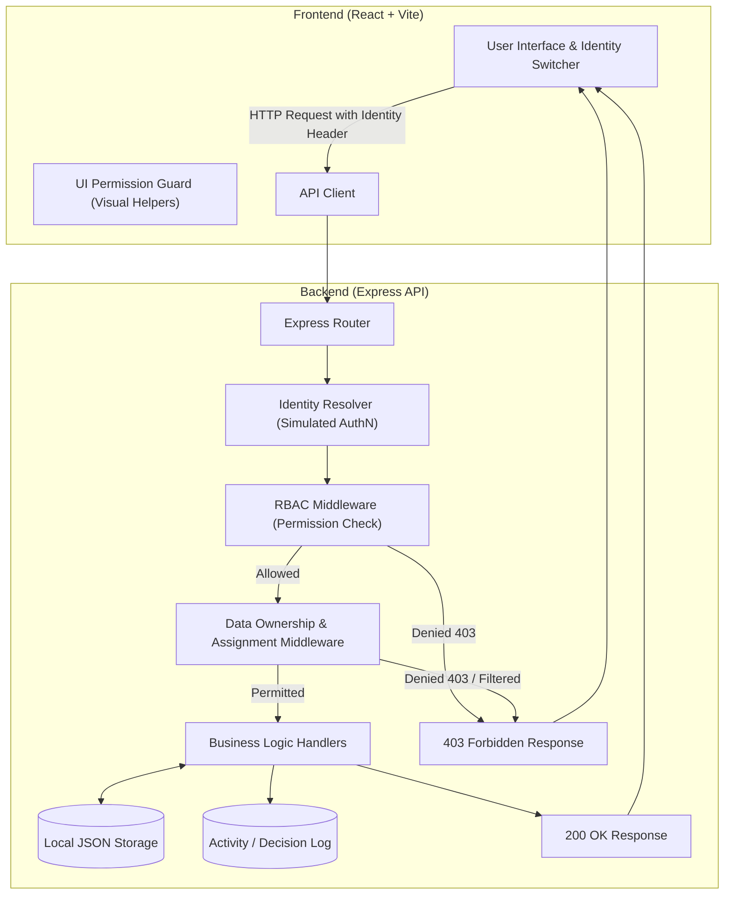

# Project Plan: Affiliate Access Lab (RBAC & Least-Privilege Prototype)

## 1. Problem Statement
In affiliate marketing platforms, sensitive business and financial data (such as commission rates, bank payout details, referral links, marketing performance metrics, and proprietary campaign settings) are accessed by multiple parties: platform administrators, affiliate managers, individual affiliates, and automated tools/agents.

Without rigorous access control:
- An affiliate might view a competitor affiliate's earnings or private contact info (**Data Leakage / Broken Object Level Authorization**).
- An affiliate manager might mistakenly edit platform-wide commission rules or wipe accounts (**Privilege Escalation**).
- An automated assistant/bot might inadvertently query and expose confidential partner records (**Over-privileged Agent Risk**).
- Frontend-only restrictions (such as disabling a button in the browser) give a false sense of security, allowing any tech-savvy user to bypass the UI and execute unauthorized API calls directly with tools like Postman or `curl`.

To solve this, modern applications must implement **server-enforced Role-Based Access Control (RBAC)** coupled with **Least-Privilege** and **Data Ownership checks**.

---

## 2. Business Objective
The primary business objective is to design and build an educational, interactive, and transparent prototype called **Affiliate Access Lab**. 

This application will demonstrate:
1. How permissions are organized cleanly into distinct roles.
2. How the backend server reliably blocks unauthorized requests regardless of what the frontend UI displays.
3. How data ownership prevents one affiliate from accessing another affiliate’s sensitive performance and commission records.
4. How an automated AI agent can be safely integrated under the principle of least privilege (reading aggregate trends without accessing individual identities or write actions).
5. How developers, security analysts, and stakeholders can audit, test, and observe access decisions in real time.

---

## 3. Foundational Security Concepts Explained Simply

To understand the architecture, we distinguish five core security concepts using an affiliate portal analogy:

| Concept | Plain English Definition | Real-World Affiliate Portal Analogy |
| :--- | :--- | :--- |
| **Authentication (AuthN)** | Verifying **WHO** you are (Identity verification). | Presenting your badge or passport at the building entrance so the guard verifies you are Alice. |
| **Authorization (AuthZ)** | Determining **WHAT** you are allowed to do. | Checking if Alice has permission to enter Room 402 or delete a file on the shared drive. |
| **RBAC (Role-Based Access Control)** | Grouping permissions into roles, then assigning roles to identities. Instead of giving 50 individual permissions to each user, we assign a "Role" (e.g., *Affiliate Manager*). | A hospital gives the role "Doctor" access to patient charts, rather than granting file-by-file permissions to 500 individual physicians. |
| **Least Privilege (PoLP)** | Giving an identity **only** the bare minimum permissions needed to complete its designated job—nothing more, nothing less. | A cleaning robot is given a keycard that opens hallway doors and trash chutes, but *cannot* open the executive financial vault or modify employee contracts. |
| **Data Ownership & Scoping** | Even if your role has permission to "Read Affiliates", this check determines **WHICH SPECIFIC RECORDS** you can read (e.g., your own profile vs. all profiles). | Both Alice and Bob have the role "Affiliate". Alice can read affiliate reports, but only *her own* commission report—never Bob's. |

---

## 4. What RBAC Means & Why This Prototype Needs It
**RBAC** stands for *Role-Based Access Control*. In RBAC:
- **Permissions** are fine-grained actions (e.g., `affiliates:read:own`, `affiliates:read:all`, `affiliates:create`, `commissions:approve`, `reports:read:aggregate`).
- **Roles** are collections of related permissions (e.g., `admin`, `affiliate_manager`, `affiliate_user`, `ai_agent`).
- **Users** are assigned one or more roles.

### Why This Prototype Needs RBAC:
1. **Separation of Duties:** Administrators manage system policies; managers manage their assigned affiliates; affiliates only view their own performance and links.
2. **Preventing Broken Access Control (OWASP Top 10 #1):** Without strict backend enforcement, malicious or curious users can inspect network traffic and call endpoints they should not have access to.
3. **Safe AI Integration:** AI tools need strict boundaries. In this prototype, the AI assistant role is strictly limited to aggregate reporting permissions and denied access to raw PII (Personally Identifiable Information) or mutating endpoints.

---

## 5. Project Scope

### Features Included:
- **Simulated Identity Switcher:** A prominent UI control allowing instant switching between demo identities (Admin, Affiliate Manager, Affiliate User, Simulated AI Agent) to observe different permission levels.
- **Role & Permission Matrix View:** An interactive visual matrix in the UI showing exactly which roles have which permissions.
- **Affiliate Management Dashboard:**
  - View affiliate list (Admins and Managers see assigned/all; Affiliates see only their own card).
  - Create and update affiliate records (enforced by backend permission checks).
  - Affiliate performance & commission tracking (filtered by data ownership).
- **Simulated AI Agent Summary:** A designated section where a simulated AI assistant generates aggregate market insights using only pre-approved aggregate statistics, demonstrating least-privilege boundary enforcement.
- **Live Security Demonstration / "Try Unauthorized Action" Sandbox:** A dedicated panel in the UI allowing the user to intentionally attempt forbidden actions (e.g., an affiliate trying to delete another affiliate or an AI agent trying to edit payout terms) to inspect the resulting backend `403 Forbidden` response.
- **In-App Activity / Decision Log:** A live log stream showing backend decisions (`200 OK` vs `403 Forbidden`, user ID, role, requested permission, and outcome).
- **Automated Backend Security Tests:** Automated unit/integration tests verifying authorization, data ownership isolation, and denial of spoofed or unauthorized requests.

### Features Explicitly Excluded:
- External databases (Supabase, Firebase, PostgreSQL, MongoDB, etc.).
- Cloud identity providers (Auth0, Cognito, Firebase Auth, OAuth2/OIDC servers).
- Production password hashing, email verification, or session tokens across browsers (simulated identity selection will be used locally and clearly documented as such).
- External LLM API calls (OpenAI, Gemini API keys, etc.) — simulated deterministic AI logic will be used to demonstrate agent permission constraints without external dependencies.
- Cloud deployment or container orchestration (Kubernetes, AWS, etc.).
- Audit compliance reports, EOD reports, or marketing publications.

---

## 6. Proposed Technology Stack & Justification

| Layer | Chosen Technology | Justification |
| :--- | :--- | :--- |
| **Runtime & Language** | **Node.js (v24+) & Modern JavaScript (ES Modules)** | JavaScript is native to both frontend and backend. Using ES Modules provides clean imports/exports without compilation overhead or TypeScript build configuration delays, keeping the codebase immediately readable and transparent for beginners. |
| **Backend Framework** | **Express.js** | Minimal, battle-tested, and transparent. Middleware in Express provides the cleanest educational mental model for RBAC: `Request -> authMiddleware -> rbacMiddleware -> handler`. |
| **Frontend Framework** | **React with Vite** | Vite delivers instant hot-reloading and high-performance developer experience. React's component model cleanly demonstrates state-driven UI changes based on active roles. |
| **Styling** | **Tailwind CSS (or clean modern CSS utility classes)** | Rapidly builds a sleek, professional, modern dashboard with visual badges for roles and statuses. |
| **Data Storage** | **Local JSON Files (in `/backend/data`)** | Fully self-contained, human-readable, requires zero external setup or database installation, and resets easily. |
| **Testing** | **Node.js Built-in Test Runner (`node --test`) or Supertest** | Zero heavy test frameworks required; fast, reliable execution for testing HTTP status codes (`200`, `401`, `403`). |

---

## 7. Proposed Architecture

---

## 8. Main Development Milestones

1. **Phase 1: Project Plan (Current)** — Finalize problem statement, definitions, scope, tech stack, and limitations. Output: `PLAN.md`.
2. **Phase 2: Requirement Gathering** — Define user personas, role responsibilities, functional & non-functional requirements, data assignment rules, and compile the full Role-Permission Matrix. Output: `REQUIREMENTS.md`, `RBAC_PERMISSION_MATRIX.md`.
3. **Phase 3: Design** — Define system architecture, data models, middleware contracts, API endpoint specs, UI wireframes, and test matrices. Output: `ARCHITECTURE.md`, `API_DESIGN.md`, `UI_DESIGN.md`, `TEST_PLAN.md`.
4. **Phase 4: Build & Verify** — Step-by-step implementation:
   - Backend setup & local JSON data stores.
   - RBAC & ownership enforcement middlewares.
   - API endpoints (affiliates, stats, AI summary, activity log).
   - Automated test suite execution.
   - React frontend with identity switcher, dashboards, permission viewer, and unauthorized action simulator.
   - Comprehensive walkthrough and demonstration script.

---

## 9. Testing Strategy

The prototype will be validated through automated tests and interactive verification:
1. **Allowed Access Tests:** Verifying that authorized roles successfully receive `200 OK` and expected data.
2. **Denied Access Tests (RBAC):** Verifying that unauthorized roles receive `403 Forbidden` with a standardized, safe error message.
3. **Data Ownership Isolation Tests:** Verifying that an affiliate user querying `/api/affiliates/aff_2` when logged in as `aff_1` is strictly rejected with `403 Forbidden`.
4. **Direct API Bypassing Tests:** Sending HTTP requests directly to Express endpoints without frontend headers or with spoofed parameters to confirm backend-only enforcement.
5. **AI Agent Boundary Tests:** Verifying that the AI agent role can access aggregate stats, but is immediately rejected when requesting individual affiliate records or write operations.

---

## 10. Expected Final Deliverables

- Complete, executable source code:
  - `/backend`: Express application, RBAC middleware, local JSON storage, and automated tests.
  - `/frontend`: React + Vite application with dashboard, identity switcher, unauthorized action sandbox, and activity log.
- Documentation suite:
  - `README.md`: Quickstart, prerequisites, start commands, and walkthrough guide.
  - `PLAN.md`: Approved project plan.
  - `REQUIREMENTS.md`: Detailed functional and non-functional requirements.
  - `RBAC_PERMISSION_MATRIX.md`: Complete matrix of roles, permissions, scopes, and denied behaviors.
  - `ARCHITECTURE.md`: Detailed architecture and request lifecycle diagrams.
  - `API_DESIGN.md`: Full API endpoint specification.
  - `UI_DESIGN.md`: Screen layouts, component hierarchies, and user journeys.
  - `TEST_PLAN.md`: Comprehensive test cases and security assertions.

---

## 11. Known Limitations of a Local Prototype

1. **Simulated Authentication vs. Real Auth:**
   - In this prototype, switching identities is done via an in-app dropdown sending a simulated identity header (e.g., `x-demo-user-id: usr_admin`).
   - *Why this is used:* Allows seamless, immediate switching between 4 different roles on one screen for demonstration and testing without maintaining separate browser sessions or login credentials.
   - *Production requirement:* Production systems must use cryptographically signed tokens (JWTs or secure session cookies) issued by a verified identity provider after multi-factor or password authentication.
2. **Single-Node In-Memory / File Storage:**
   - Data is stored in local JSON files. It does not handle multi-server clustering, distributed locking, or high-concurrency transactions.
3. **Simulated AI Agent Logic:**
   - The AI agent's analysis is computed using deterministic statistical aggregation on the backend to demonstrate *least-privilege boundaries* without incurring API costs, latency, or external internet dependencies.

