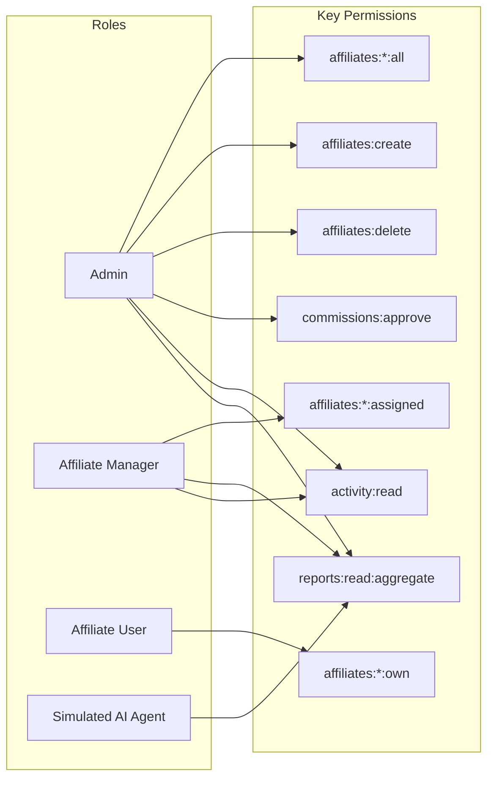

# Role-Based Access Control (RBAC) Permission Matrix

**Project:** Affiliate Access Lab — RBAC and Least-Privilege Prototype  
**Phase:** Phase 2 — Requirement Gathering  
**Status:** Draft for Review & Approval  

---

## 1. Overview of Roles

| Role Key | Role Name | Purpose & High-Level Scope |
| :--- | :--- | :--- |
| `admin` | **System Administrator** | Complete control over platform settings, all affiliate accounts, commission approvals, and system-wide activity logs. |
| `affiliate_manager` | **Affiliate Manager** | Portfolio management for assigned affiliates. Can review performance and update notes for assigned affiliates only. |
| `affiliate_user` | **Affiliate Partner** | Individual publisher/creator. Strictly limited to viewing own tracking links, personal earnings, and updating own contact details. |
| `ai_agent` | **Simulated AI Analytical Agent** | Automated reporting service operating under least privilege. Restricted to aggregate statistics; blocked from all personal records and mutations. |

---

## 2. Granular Permissions Definition

| Permission Key | Description | Category |
| :--- | :--- | :--- |
| `affiliates:read:all` | View all affiliate accounts across the platform | Affiliates |
| `affiliates:read:assigned` | View only affiliate accounts assigned to the manager | Affiliates |
| `affiliates:read:own` | View only the authenticated user's own affiliate record | Affiliates |
| `affiliates:create` | Onboard and register new affiliate partners | Affiliates |
| `affiliates:update:all` | Modify any affiliate record, commission tier, or assigned manager | Affiliates |
| `affiliates:update:assigned` | Modify notes and status for assigned affiliates | Affiliates |
| `affiliates:update:own` | Modify personal profile/payout information | Affiliates |
| `affiliates:delete` | Terminate or remove an affiliate account | Affiliates |
| `commissions:read:all` | View platform-wide commission transactions and payout ledgers | Financial |
| `commissions:read:assigned` | View commission totals for assigned affiliates | Financial |
| `commissions:read:own` | View personal earned commissions and payout history | Financial |
| `commissions:approve` | Authorize and execute financial commission payouts | Financial |
| `reports:read:aggregate` | Query anonymized, high-level summary and trend statistics | Reporting |
| `activity:read` | Inspect access decision logs and platform audit trails | System Audit |

---

## 3. Role-to-Permissions Mapping



### Complete Permission Assignment by Role:
- **`admin`**:
  `affiliates:read:all`, `affiliates:create`, `affiliates:update:all`, `affiliates:delete`, `commissions:read:all`, `commissions:approve`, `reports:read:aggregate`, `activity:read`
- **`affiliate_manager`**:
  `affiliates:read:assigned`, `affiliates:update:assigned`, `commissions:read:assigned`, `reports:read:aggregate`, `activity:read`
- **`affiliate_user`**:
  `affiliates:read:own`, `affiliates:update:own`, `commissions:read:own`
- **`ai_agent`**:
  `reports:read:aggregate`

---

## 4. Operation-by-Operation Access Control Matrix

The following table defines every API operation, the required permission, role eligibility, data scope, and expected denied behavior:

| Operation | HTTP Method & Route | Required Permission | Admin | Affiliate Manager | Affiliate User | AI Agent | Data Scope Enforced | Denied Behavior |
| :--- | :--- | :--- | :---: | :---: | :---: | :---: | :--- | :--- |
| **List Affiliates** | `GET /api/affiliates` | `affiliates:read:all` OR `affiliates:read:assigned` OR `affiliates:read:own` | ✅ ALLOWED | ✅ ALLOWED | ✅ ALLOWED | ❌ DENIED | **Admin:** All records.<br>**Manager:** Assigned only.<br>**Affiliate:** Own profile only.<br>**AI Agent:** None. | Returns `403 Forbidden` (`INSUFFICIENT_PERMISSIONS`). AI Agent is completely blocked. |
| **Get Affiliate by ID** | `GET /api/affiliates/:id` | `affiliates:read:all` OR `affiliates:read:assigned` OR `affiliates:read:own` | ✅ ALLOWED | ✅ (Assigned only) | ✅ (Own only) | ❌ DENIED | **Admin:** Any ID.<br>**Manager:** Only if `aff.assignedManagerId === user.id`.<br>**Affiliate:** Only if `aff.userId === user.id`. | Returns `403 Forbidden` (`RESOURCE_ACCESS_DENIED` or `INSUFFICIENT_PERMISSIONS`). |
| **Create Affiliate** | `POST /api/affiliates` | `affiliates:create` | ✅ ALLOWED | ❌ DENIED | ❌ DENIED | ❌ DENIED | **Admin:** Global creation. | Returns `403 Forbidden` (`INSUFFICIENT_PERMISSIONS`). |
| **Update Affiliate** | `PUT /api/affiliates/:id` | `affiliates:update:all` OR `affiliates:update:assigned` OR `affiliates:update:own` | ✅ ALLOWED | ✅ (Assigned only) | ✅ (Own only) | ❌ DENIED | **Admin:** Can edit all fields.<br>**Manager:** Can edit notes/status.<br>**Affiliate:** Can only edit contact/payout info.<br>**AI Agent:** Denied. | Returns `403 Forbidden`. If Manager attempts to edit unassigned affiliate, denied via `RESOURCE_ACCESS_DENIED`. If restricted fields are modified, denied via `RESTRICTED_FIELD_UPDATE_DENIED`. |
| **Delete Affiliate** | `DELETE /api/affiliates/:id` | `affiliates:delete` | ✅ ALLOWED | ❌ DENIED | ❌ DENIED | ❌ DENIED | **Admin:** Can delete record. | Returns `403 Forbidden` (`INSUFFICIENT_PERMISSIONS`). |
| **Get Commission Records** | `GET /api/commissions` | `commissions:read:all` OR `commissions:read:assigned` OR `commissions:read:own` | ✅ ALLOWED | ✅ (Assigned only) | ✅ (Own only) | ❌ DENIED | **Admin:** Full ledger.<br>**Manager:** Team earnings.<br>**Affiliate:** Own earnings only.<br>**AI Agent:** None. | Returns `403 Forbidden` (`INSUFFICIENT_PERMISSIONS`). |
| **Approve Commission** | `POST /api/commissions/:id/approve` | `commissions:approve` | ✅ ALLOWED | ❌ DENIED | ❌ DENIED | ❌ DENIED | **Admin:** Can approve payouts. | Returns `403 Forbidden` (`INSUFFICIENT_PERMISSIONS`). |
| **Get Aggregate Stats** | `GET /api/reports/aggregate-stats` | `reports:read:aggregate` | ✅ ALLOWED | ✅ ALLOWED | ❌ DENIED | ✅ ALLOWED | Anonymized platform metrics only (Total Affiliates, Conversion Rate, Overall Revenue Trend). No individual records. | Returns `403 Forbidden` (`INSUFFICIENT_PERMISSIONS`). |
| **View Activity Log** | `GET /api/activity` | `activity:read` | ✅ ALLOWED | ✅ ALLOWED | ❌ DENIED | ❌ DENIED | System-wide access decision trail. | Returns `403 Forbidden` (`INSUFFICIENT_PERMISSIONS`). |

---

## 5. Explicit Data Scoping & Assignment Rules

RBAC determines whether a user can call a verb (e.g., `affiliates:read`). Data Scoping determines **which rows/documents** the user can see.

### Rule 1: Admin Data Scope
- Condition: `user.role === 'admin'`
- Scope: **Global**. No filtering is applied.

### Rule 2: Affiliate Manager Assignment Scope
- Condition: `user.role === 'affiliate_manager'`
- Scope: **Assigned Portfolio**.
- Query Filter: `records.filter(item => item.assignedManagerId === user.id)`
- Target Lookup: If requesting `/api/affiliates/:id`, verify:
  ```js
  if (affiliate.assignedManagerId !== req.user.id) {
    return res.status(403).json({
      error: "Forbidden",
      code: "OBJECT_ASSIGNMENT_DENIED",
      message: "Access Denied: This affiliate is not assigned to your management portfolio."
    });
  }
  ```

### Rule 3: Affiliate User Ownership Scope
- Condition: `user.role === 'affiliate_user'`
- Scope: **Self / Own Record**.
- Query Filter: `records.filter(item => item.userId === user.id)`
- Target Lookup: If requesting `/api/affiliates/:id`, verify:
  ```js
  if (affiliate.userId !== req.user.id) {
    return res.status(403).json({
      error: "Forbidden",
      code: "OBJECT_OWNERSHIP_DENIED",
      message: "Access Denied: You are not authorized to view another affiliate's profile."
    });
  }
  ```

### Rule 4: Simulated AI Agent Scope (Least Privilege Guardrail)
- Condition: `user.role === 'ai_agent'`
- Scope: **Aggregate Summary Only**.
- Constraints:
  - Allowed Endpoints: Whitelisted strictly to `GET /api/reports/aggregate-stats`.
  - Blocked Endpoints: Any endpoint containing individual records (`/api/affiliates`, `/api/commissions`, `/api/activity`).
  - Blocked Methods: Any mutating HTTP method (`POST`, `PUT`, `PATCH`, `DELETE`).

---

## 6. Standardized Denied Response Format

When any access control check fails, the backend returns a standardized JSON structure with HTTP status code `403 Forbidden`:

```json
{
  "success": false,
  "error": "Forbidden",
  "code": "INSUFFICIENT_PERMISSIONS",
  "message": "Access Denied: Missing required permission [affiliates:create]",
  "details": {
    "user": "usr_aff_alice",
    "role": "affiliate_user",
    "requiredPermission": "affiliates:create",
    "action": "POST /api/affiliates",
    "timestamp": "2026-11-03T12:00:00.000Z"
  }
}
```

If an identity fails the data scoping check (e.g., Alice attempting to access Bob's record):
```json
{
  "success": false,
  "error": "Forbidden",
  "code": "OBJECT_OWNERSHIP_DENIED",
  "message": "Access Denied: You do not have ownership of record aff_bob",
  "details": {
    "user": "usr_aff_alice",
    "role": "affiliate_user",
    "targetRecordId": "aff_bob",
    "action": "GET /api/affiliates/aff_bob",
    "timestamp": "2026-11-03T12:00:00.000Z"
  }
}
```

This ensures predictable error handling on the frontend and provides clear, auditable logs without exposing confidential internal system traces.

