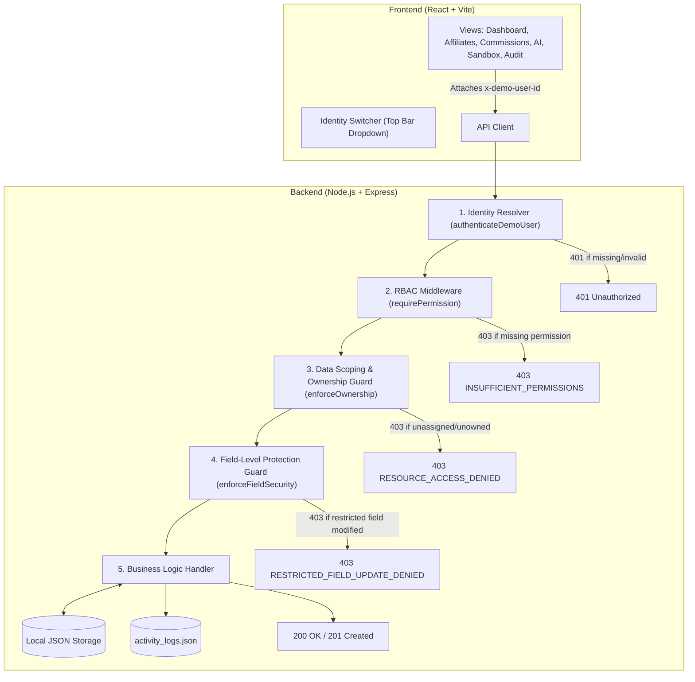

# Affiliate Access Lab — RBAC and Least-Privilege Prototype

> An interactive, educational prototype demonstrating **Role-Based Access Control (RBAC)**, **Least Privilege**, and **Data Ownership Boundaries** in an affiliate marketing management application. Built from scratch with **React + Vite**, **Node.js + Express**, and **local JSON file storage**.

---

## 1. Quick Start Guide

### Prerequisites
- **Node.js:** v18+ (tested on Node.js v24.13.0)
- **npm:** v9+ (tested on npm 11.6.2)
- Zero external database installation required (uses local JSON files in `backend/data/`).

### Step 1: Install Dependencies
Open a terminal in the project root:
```bash
# Install backend dependencies
cd backend && npm install

# Install frontend dependencies
cd ../frontend && npm install
```

### Step 2: Start the Backend & Frontend Servers
You can run the backend and frontend in two separate terminal windows:

**Terminal 1 (Backend API - Port 5000):**
```bash
cd backend
npm start
```
*(Backend will log: `[Affiliate Access Lab] Backend listening on port 5000`)*

**Terminal 2 (React Frontend - Port 5173):**
```bash
cd frontend
npm run dev
```
*(Vite will log: `Local: http://localhost:5173/`)*

Alternatively, from the project root:
```bash
# Terminal 1:
npm run start:backend

# Terminal 2:
npm run start:frontend
```

### Step 3: Open in Browser
Open your browser and navigate to:
**`http://localhost:5173`**

---

## 2. Running Automated Security Tests

The prototype includes an automated backend test suite verifying all 20 security assertions (RBAC verbs, data ownership, manager portfolio boundaries, restricted field updates, AI least privilege, and role spoofing):

```bash
# From project root:
npm test

# Or directly in the backend folder:
cd backend && npm test
```

### Verified Test Results:
```text
✔ TC-01: Health check is public and returns 200 OK
✔ TC-02: Missing identity header returns 401 MISSING_IDENTITY
✔ TC-03: Invalid identity header returns 401 INVALID_IDENTITY
✔ TC-04: Admin lists all affiliates across platform (Global scope)
✔ TC-05: Affiliate Manager Sarah sees only assigned affiliates (Alice & Bob)
✔ TC-06: Affiliate User Alice sees only her own record
✔ TC-07: Admin creates new affiliate successfully (201 Created)
✔ TC-08: Affiliate User Alice denied creation (403 INSUFFICIENT_PERMISSIONS)
✔ TC-09: Affiliate Manager Sarah denied creation (403 INSUFFICIENT_PERMISSIONS)
✔ TC-10: Affiliate Alice reading Bob is rejected (403 RESOURCE_ACCESS_DENIED / OWNERSHIP_VIOLATION)
✔ TC-11: Manager Sarah reading unassigned Charlie is rejected (403 RESOURCE_ACCESS_DENIED / ASSIGNMENT_VIOLATION)
✔ TC-12: Affiliate Alice modifying Bob is rejected (403 RESOURCE_ACCESS_DENIED)
✔ TC-13: Affiliate Alice modifying commissionRate is rejected (403 RESTRICTED_FIELD_UPDATE_DENIED)
✔ TC-14: Admin approves commission payout (200 OK)
✔ TC-15: Affiliate Manager Sarah approving payout is rejected (403 INSUFFICIENT_PERMISSIONS)
✔ TC-16: Simulated AI Agent reads aggregate stats (200 OK, zero PII)
✔ TC-17: Simulated AI Agent reading affiliate list is rejected (403 INSUFFICIENT_PERMISSIONS)
✔ TC-18: Simulated AI Agent creating affiliate is rejected (403 INSUFFICIENT_PERMISSIONS)
✔ TC-19: Body-level role spoofing is ignored; server enforces backend role
✔ TC-20: In-App Activity Log records audit stream (Admin: 200 OK)

ℹ tests 20 | pass 20 | fail 0
```

---

## 3. High-Level Architecture & Request Flow



---

## 4. The Four Actors & Their Boundaries

| Actor Persona | Role Key | Permitted Actions | Data Scope | Strict Boundaries |
| :--- | :--- | :--- | :--- | :--- |
| **Alex Carter** | `admin` | View all, create/delete affiliates, edit all fields, approve payouts. | **Global** (All records) | None. |
| **Sarah Jenkins** | `affiliate_manager` | View assigned affiliates (Alice & Bob), update notes. | **Assigned Portfolio** | Cannot create affiliates, cannot modify commission rates, cannot view David's affiliates. |
| **Alice Rivera** | `affiliate_user` | View personal earnings, copy tracking link, update website. | **Own Record Only** | Cannot view Bob's profile, cannot edit commission rate, cannot approve payouts. |
| **MarketPulse AI** | `ai_agent` | Query aggregate market statistics. | **Aggregate Only** | Cannot view raw PII (names, emails), cannot access individual cards, zero write/mutation access. |

---

## 5. Five-Minute Demonstration Sequence

Follow this step-by-step walkthrough to demonstrate the prototype to stakeholders or peers:

1. **Open the Dashboard (`http://localhost:5173`):**
   - Notice the **Simulated Identity Switcher** in the top bar. The active actor is **Alex Carter (Admin)**.
   - Note the **Granted Server Permissions** cloud showing all administrative permissions.

2. **Demonstrate Global Admin Access:**
   - Click the **Affiliates** tab. Alex sees all 3 affiliates (Alice, Bob, and Charlie).
   - The *"Onboard New Affiliate"* button is enabled.
   - Click the **Commissions** tab. Alex sees all payouts and has an active **"Approve Payout"** button.

3. **Demonstrate Manager Portfolio Assignment:**
   - Switch the top dropdown to **Sarah Jenkins (Affiliate Manager)**.
   - Click the **Affiliates** tab. Sarah sees only **2 affiliates** (Alice and Bob). Charlie Gomez (assigned to David Kim) is completely filtered out on the server!
   - Note that the *"Onboard New Affiliate"* button is disabled with a lock icon.

4. **Demonstrate Individual Affiliate Isolation:**
   - Switch the top dropdown to **Alice Rivera (Affiliate Partner)**.
   - Click the **Affiliates** tab. Alice sees **only 1 affiliate card** (her own). Bob's and Charlie's cards do not exist in the response payload.
   - Click **"Inspect & Edit"**. Note that the **Commission Rate** field is locked with a padlock, and the internal manager notes are completely sanitized by the backend.

5. **Demonstrate the Simulated AI Agent under Least Privilege:**
   - Switch the top dropdown to **MarketPulse AI Agent**.
   - Click the **Affiliates** tab. The server returns a **403 Forbidden** screen because the agent is disallowed from viewing individual partner PII.
   - Click the **AI Agent Summary** tab. The agent displays aggregate conversions, click totals, and an executive synthesis, with an audit card proving **0% PII exposure**.

6. **Demonstrate Real Attack Vectors in the Security Sandbox:**
   - Click the **Security Sandbox** tab.
   - Click **"1. Privilege Escalation"**: Watch Alice attempt to onboard a partner and inspect the live **403 INSUFFICIENT_PERMISSIONS** response.
   - Click **"2. Cross-Tenant Tampering (IDOR)"**: Watch Alice attempt to fetch Bob's profile and inspect the live **403 RESOURCE_ACCESS_DENIED (OWNERSHIP_VIOLATION)** response.
   - Click **"4. Restricted Field Modification"**: Watch Alice attempt to raise her commission rate to 99% and inspect the live **403 RESTRICTED_FIELD_UPDATE_DENIED** response.

7. **Inspect the Real-Time Decision Log:**
   - Click the **Decision Log** tab.
   - Observe how every allowed and denied operation from your clicks is recorded with timestamps, user ID, endpoint, and status codes.

---

## 6. Project Documentation Index

- [`PLAN.md`](PLAN.md) — Comprehensive problem statement, security definitions, and milestones.
- [`REQUIREMENTS.md`](REQUIREMENTS.md) — Functional and non-functional requirements and conceptual distinctions.
- [`RBAC_PERMISSION_MATRIX.md`](RBAC_PERMISSION_MATRIX.md) — Detailed mapping of operations, roles, scopes, and denied behaviors.
- [`ARCHITECTURE.md`](ARCHITECTURE.md) — System architecture, request pipeline, and local JSON schemas.
- [`API_DESIGN.md`](API_DESIGN.md) — REST API specification with standardized status and error codes.
- [`UI_DESIGN.md`](UI_DESIGN.md) — Wireframes, component breakdown, and user journeys.
- [`TEST_PLAN.md`](TEST_PLAN.md) — Automated security test cases and assertions.

---

## 7. Known Limitations of a Local Prototype

1. **Simulated Authentication Header:**
   - The frontend passes `x-demo-user-id: <user_id>`. This is an educational mechanism designed for instant role switching without maintaining separate browser logins.
   - *Production Requirement:* Production apps must use cryptographically signed tokens (JWTs) or secure `HttpOnly` session cookies issued after verified password/MFA authentication.
2. **Local JSON File Storage:**
   - Data is stored in `backend/data/*.json`. It does not support distributed database transactions or multi-node clustering.
3. **Simulated AI Synthesis:**
   - The AI agent's analysis is calculated deterministically on the server from aggregate statistics without connecting to external cloud LLM APIs, ensuring zero external dependencies and zero cost.

---

## 8. Ten Likely Manager Questions & Accurate Answers

1. **Q: Why didn't we just hide buttons in React using `user.role === 'admin'`?**  
   *A:* Hiding a button is purely a user experience convenience. Any user can open developer tools or Postman and send an HTTP request directly to the API endpoint. True security must be enforced on the backend server.

2. **Q: How does the server prevent Alice from seeing Bob's earnings if both are "Affiliate Users"?**  
   *A:* RBAC checks if the role can perform the verb (`affiliates:read:own`). Then the Data Ownership middleware verifies whether the record's `userId` matches the requester's `id`. If they differ, the backend halts execution with `403 RESOURCE_ACCESS_DENIED`.

3. **Q: Can a user spoof their role by sending `{ "role": "admin" }` in the request body?**  
   *A:* No. The server looks up the user identity in `users.json` and loads the authoritative role from `roles.json`. Any client-supplied role in headers or request body is ignored.

4. **Q: How is the AI Agent kept safe under Least Privilege?**  
   *A:* The AI agent is assigned a single permission: `reports:read:aggregate`. The backend statistical route computes anonymous platform totals and strips away all names, emails, and financial details. The agent cannot call any mutation endpoint (`POST`, `PUT`, `DELETE`).

5. **Q: What happens if an affiliate manager tries to edit an affiliate assigned to another manager?**  
   *A:* The backend manager assignment check confirms `affiliate.assignedManagerId === req.user.id`. Since Charlie belongs to David Kim, Sarah Jenkins' request is rejected with `403 RESOURCE_ACCESS_DENIED (ASSIGNMENT_VIOLATION)`.

6. **Q: How are restricted fields like commission rates protected from unauthorized modification?**  
   *A:* The `enforceFieldSecurity` middleware scans the request body. If a non-admin submits changes to `commissionRate`, `assignedManagerId`, or `status`, the server rejects the request with `403 RESTRICTED_FIELD_UPDATE_DENIED`.

7. **Q: Are denied attempts tracked anywhere?**  
   *A:* Yes. Every failed or denied request (missing header, insufficient permission, ownership mismatch, or restricted field tampering) is recorded in the in-app Activity Log with HTTP status codes and rejection reasons.

8. **Q: Why are there no external databases like Supabase or PostgreSQL?**  
   *A:* To keep the prototype lightweight, fully self-contained, reproducible, and verifiable on any computer with standard Node.js without needing external network access, credentials, or cloud accounts.

9. **Q: How do we verify that the security controls actually work?**  
   *A:* We execute the automated test suite (`npm test`), which runs 20 tests directly against the Express HTTP endpoints, asserting status codes (`200`, `201`, `401`, `403`) and standardized error codes.

10. **Q: What would be required to transition this prototype into production?**  
    *A:* (1) Replace `x-demo-user-id` with secure token authentication (JWT / OAuth2 / session cookies); (2) Replace local JSON files with a production database (e.g., PostgreSQL with transactional locking); (3) Implement rate limiting, CORS origin restrictions, and structured audit log streaming (e.g., to Elasticsearch or AWS CloudWatch).

