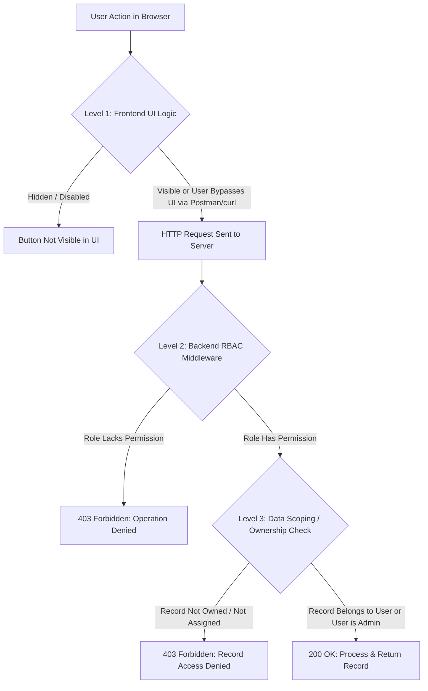

# Functional and Non-Functional Requirements

**Project:** Affiliate Access Lab — RBAC and Least-Privilege Prototype  
**Phase:** Phase 2 — Requirement Gathering  
**Status:** Draft for Review & Approval  

---

## 1. User Personas and Roles

The prototype models four realistic actors within an affiliate marketing ecosystem:

### 1.1 Admin (e.g., Alex Carter — `usr_admin_alex`)
- **Profile:** System-level executive administrator.
- **Responsibilities:**
  - Full visibility across all affiliate accounts, managers, and system settings.
  - Create new affiliates and assign them to managers.
  - Update any affiliate profile, commission rate, or account status.
  - View platform-wide financial stats and system activity logs.
- **Scope of Data Access:** **Global (All records).**

### 1.2 Affiliate Manager (e.g., Sarah Jenkins — `usr_mgr_sarah`, David Kim — `usr_mgr_david`)
- **Profile:** Regional partner manager responsible for a dedicated portfolio of affiliates.
- **Responsibilities:**
  - View performance, conversions, and contact information *only* for affiliates explicitly assigned to them.
  - Update notes and promotional tiers for their assigned affiliates.
  - Prohibited from viewing or modifying affiliates assigned to other managers.
  - Prohibited from changing platform-wide settings or accessing administrative controls.
- **Scope of Data Access:** **Assigned Portfolio Only (`assignedManagerId === currentUserId`).**

### 1.3 Affiliate User (e.g., Alice Rivera — `usr_aff_alice`, Bob Chen — `usr_aff_bob`)
- **Profile:** Independent content creator or publisher promoting products.
- **Responsibilities:**
  - View their own unique tracking link, referral statistics, and commission earnings.
  - Update their own payout preferences and profile details.
  - Prohibited from seeing any other affiliate’s revenue, email, or performance metrics.
  - Prohibited from viewing manager-only internal notes.
- **Scope of Data Access:** **Self/Own Record Only (`userId === currentUserId`).**

### 1.4 Simulated AI Agent (e.g., MarketPulse Agent — `usr_agent_spark`)
- **Profile:** An automated background analytical service designed to generate high-level trend summaries and market insights.
- **Responsibilities:**
  - Fetch aggregated metrics (e.g., total active affiliates count, average conversion rate across the platform).
  - Produce high-level descriptive summaries of platform activity.
  - **Least-Privilege Guardrail:** Strictly prohibited from accessing Personally Identifiable Information (PII) such as affiliate names, emails, banking information, or individual commission amounts.
  - **Mutation Guardrail:** Strictly prohibited from executing any `POST`, `PUT`, `PATCH`, or `DELETE` operations.
- **Scope of Data Access:** **Aggregate-Only (No individual records, no write capabilities).**

---

## 2. Functional Requirements (FR)

### FR-1: Simulated Identity Switching
- **Description:** The system must provide a prominent, accessible control in the application header to switch the active demo identity between:
  1. Admin (`Alex Carter`)
  2. Affiliate Manager 1 (`Sarah Jenkins`)
  3. Affiliate Manager 2 (`David Kim`)
  4. Affiliate User 1 (`Alice Rivera`)
  5. Affiliate User 2 (`Bob Chen`)
  6. Simulated AI Agent (`MarketPulse Agent`)
- **Requirement:** Switching identity must instantly refresh the UI state and supply the corresponding simulated authentication header (`x-demo-user-id`) to all subsequent backend API requests.
- **Safety Label:** The identity selector must be clearly labelled as **"Simulated Demo Identity (Local Testing Only)"**.

### FR-2: Role-Aware Dashboard
- **Description:** When an identity is selected, the home dashboard must display:
  - The current user's profile, active role, and assigned permission set.
  - Overview cards tailored to their role (Admins see platform totals; Managers see their team totals; Affiliates see their personal earnings; AI Agent sees aggregate trend indicators).
  - Clear visual indicators of allowed and restricted features for that role.

### FR-3: Affiliate Record Directory
- **Description:** The system must provide a directory of affiliate partners.
  - **Admin:** Sees all affiliates across the platform.
  - **Affiliate Manager:** Sees only affiliates assigned to their manager ID.
  - **Affiliate User:** Sees only their own affiliate record (other affiliates are filtered out).
  - **Simulated AI Agent:** Directory endpoint access is completely blocked (`403 Forbidden`).

### FR-4: Affiliate Detail and Performance View
- **Description:** Detailed view of an affiliate including clicks, conversions, payout rates, and internal notes.
  - **Admin:** Can view any affiliate detail.
  - **Affiliate Manager:** Can view detail only if the affiliate is assigned to them.
  - **Affiliate User:** Can view only their own detail. Internal manager notes must be omitted or sanitized.
  - **Simulated AI Agent:** Denied access.

### FR-5: Affiliate Management (Create & Update)
- **Description:** Operations to create new affiliates and edit existing ones.
  - **Admin:** Can create new affiliates and edit any affiliate record.
  - **Affiliate Manager:** Cannot create new affiliates (platform policy), but can update promotional notes or status for *assigned* affiliates.
  - **Affiliate User:** Cannot create affiliates; can only update their own profile information (cannot edit commission rate or assigned manager).
  - **Simulated AI Agent:** Blocked from all create/update endpoints (`403 Forbidden`).

### FR-6: Commission & Financial Data Access
- **Description:** Reviewing commission payouts and revenue.
  - **Admin:** Can view all financial ledgers and approve payout batches.
  - **Affiliate Manager:** Can view commission totals for their assigned team.
  - **Affiliate User:** Can view only their own personal payout history.
  - **Simulated AI Agent:** Blocked from all raw commission endpoints (`403 Forbidden`).

### FR-7: Security Playground & Unauthorized Action Demonstration
- **Description:** An interactive panel where users can intentionally attempt forbidden operations to observe how security is enforced.
- **Scenarios to Demonstrate:**
  1. **Privilege Escalation:** An Affiliate User attempts to call `POST /api/affiliates` (create an affiliate).
  2. **Cross-Tenant Data Tampering (BOLA/IDOR):** Affiliate Alice attempts to update Bob’s payout rate via `PUT /api/affiliates/aff_bob`.
  3. **Manager Boundary Violation:** Manager Sarah attempts to view or edit David’s affiliate via `GET /api/affiliates/aff_charlie`.
  4. **AI Agent Boundary Violation:** The AI Agent attempts to query raw affiliate PII via `GET /api/affiliates`.
- **Requirement:** Each attempt must issue a real HTTP call to the backend and display the raw response status (`403 Forbidden`), timestamp, and rejection explanation.

### FR-8: Simulated AI Agent Analytics
- **Description:** A dedicated interface demonstrating least privilege in autonomous agents.
  - The agent queries `GET /api/reports/aggregate-stats` (which requires `reports:read:aggregate`).
  - The backend returns anonymized totals: total affiliate count, aggregate monthly conversions, platform average conversion rate.
  - The frontend displays the AI's generated executive summary based solely on this aggregate payload.
  - The UI explicitly highlights that no personal data (names, emails, bank accounts) was transmitted to or accessed by the agent.

### FR-9: In-App Activity & Decision Stream
- **Description:** A live stream displaying access decisions made by the backend.
  - Records every request: timestamp, requesting identity, role, target endpoint, requested permission, outcome (`200 ALLOWED` or `403 DENIED`), and reason.
  - Enables the user to observe both successful operations and blocked intrusion attempts.

---

## 3. Explicit Data Assignment & Ownership Rules

To ensure predictable security behavior, the following assignment rules are established:

```
[Affiliate Record]
  ├── id: "aff_alice"
  ├── userId: "usr_aff_alice"          <-- Determines Affiliate Ownership
  ├── assignedManagerId: "usr_mgr_sarah" <-- Determines Manager Assignment
  ├── name: "Alice Rivera"
  ├── email: "alice@example.com"
  ├── commissionRate: 15.0
  └── internalNotes: "Top tech reviewer"
```

1. **Admin Rule:** `currentUser.role === 'admin'` → Full access to all records.
2. **Manager Rule:** `currentUser.role === 'affiliate_manager'` → Access permitted IF AND ONLY IF `record.assignedManagerId === currentUser.id`.
3. **Affiliate Rule:** `currentUser.role === 'affiliate_user'` → Access permitted IF AND ONLY IF `record.userId === currentUser.id`.
4. **AI Agent Rule:** `currentUser.role === 'ai_agent'` → Zero access to individual affiliate records (`record === null`).

---

## 4. Non-Functional Requirements (NFR)

### NFR-1: Server-Side Enforcement (Zero Trust in Client UI)
- The backend must never trust the client's self-reported role or UI state.
- Every API endpoint handling sensitive operations must execute:
  1. Identity verification.
  2. Permission check (RBAC).
  3. Data ownership/assignment check (Scoping).
- A user crafting a raw `curl` or Postman request without valid authorization must be blocked with `403 Forbidden`.

### NFR-2: Architectural Separation
- The frontend (React + Vite) and backend (Express) must reside in separate directories.
- Communication between frontend and backend must occur strictly over HTTP JSON APIs.

### NFR-3: Beginner-Friendly & Maintainable Code
- Code should be clean, modular, and heavily commented.
- Middleware functions must be distinct and readable (e.g., `authenticateDemoUser`, `requirePermission`, `enforceDataOwnership`).

### NFR-4: Standardized Error & Denial Responses
- When access is denied, the server must return a standardized JSON response:
  ```json
  {
    "error": "Forbidden",
    "code": "ACCESS_DENIED",
    "message": "You do not possess the required permission: [affiliates:create]",
    "requiredPermission": "affiliates:create",
    "userRole": "affiliate_user"
  }
  ```
- No sensitive stack traces, database file paths, or private data may leak in error payloads.

### NFR-5: Self-Contained Local Persistence
- All seed data must reside in local JSON files in the `/backend/data/` folder.
- No external database (MySQL, PostgreSQL, MongoDB, Supabase, Firebase) is permitted.
- The system must provide a helper to reset the local JSON data to its default clean state.

### NFR-6: Automated Test Coverage
- An automated test suite using the Node.js built-in test runner must verify:
  - Allowed requests return `200 OK`.
  - Missing permissions return `403 Forbidden`.
  - Cross-tenant data access attempts return `403 Forbidden`.
  - Direct API requests bypassing the UI are properly denied.
  - The AI agent is strictly confined to aggregate reporting.

### NFR-7: Clear Educational Distinction of Limitations
- The documentation and UI must explicitly state that the prototype uses simulated identity selection for local demonstration and learning, distinguishing it from production-grade authentication (e.g., OAuth2, JWTs, WebAuthn, encrypted session cookies).

---

## 5. Critical Distinction: Frontend Hiding vs. Backend Rejection vs. Data Scoping

Understanding these three levels of control is the foundation of secure software engineering:



### 1. Feature Hidden in the Frontend (Usability, NOT Security)
- *What it is:* Using an `if (user.role === 'admin')` condition in React to hide a "Delete" button.
- *Why it is NOT security:* A malicious or curious user can open Chrome DevTools, inspect the JavaScript code, find the API URL, and send a request directly. Hiding a button is merely a usability feature to keep the UI clean.

### 2. Request Rejected by the Backend (RBAC Security)
- *What it is:* The Express server checks `if (!user.permissions.includes('affiliates:delete')) return res.status(403).json(...)`.
- *Why it IS security:* Even if the user sends an HTTP request using `curl`, Python, or DevTools, the server actively blocks execution before any data is modified or retrieved.

### 3. Record Filtered According to Ownership or Assignment (Data Scoping)
- *What it is:* A user has the general role permission `affiliates:read:own`. The backend verifies whether `affiliate.userId === req.user.id`. If not, it rejects or omits the record.
- *Why it is essential:* Without this, Bob could use his legitimate "Affiliate" role to query Alice's private financial records simply by changing `?id=aff_alice`. Role permissions tell us *what kind of action* is allowed; data scoping tells us *which exact records* that action applies to.

---

## 6. Authentication Limitation Disclaimer

> **IMPORTANT SECURITY NOTICE:**
> 
> This prototype is an educational environment designed to teach **Authorization (RBAC and Least Privilege)**.
> 
> In this prototype, authentication is simulated via an identity selector that attaches an `x-demo-user-id` header to HTTP requests. This allows developers to seamlessly inspect different user roles without having to log in and out with passwords.
> 
> In a **Production System**, authentication must NEVER rely on client-supplied headers. Production requires:
> - Cryptographically signed tokens (e.g., JWT signed with an asymmetric private key or HMAC secret).
> - Secure, `HttpOnly`, `SameSite` session cookies.
> - Identity verification via Multi-Factor Authentication (MFA), OAuth2 / OIDC, or secure password hashing (Argon2 / bcrypt).
> - Secure server-side session stores with automatic expiration and revocation.

