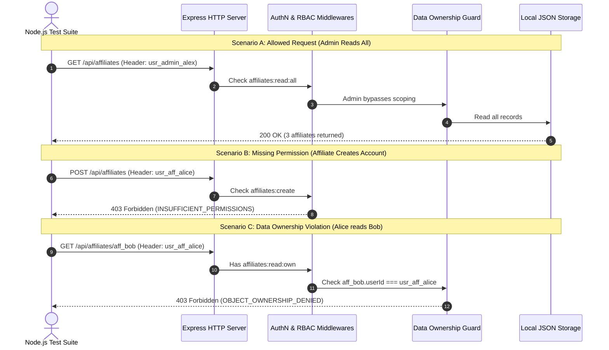

# Test Plan & Security Verification Strategy

**Project:** Affiliate Access Lab — RBAC and Least-Privilege Prototype  
**Phase:** Phase 3 — Design  
**Status:** Ready for Review & Approval  

---

## 1. Testing Strategy Overview

The testing strategy is designed to rigorously verify the **security boundaries and access control decisions** implemented by the backend API. 

### Core Testing Principles:
1. **Zero UI Reliance:** Tests will execute directly against the Express HTTP endpoints using Node.js's native test runner (`node --test`) and standard assertions (`node:assert/strict`). This proves that security is enforced on the server, not just hidden in the browser.
2. **Deterministic Assertions:** Every test checks both the **HTTP status code** (e.g., `200`, `201`, `401`, `403`) and the **machine-readable error code** (e.g., `INSUFFICIENT_PERMISSIONS`, `OBJECT_OWNERSHIP_DENIED`).
3. **Audit Trail Verification:** Tests confirm that both successful queries and unauthorized attempts are reliably recorded in the in-app Activity Log.

---

## 2. Test Execution Flow



---

## 3. Comprehensive Test Matrix

| Test ID | Test Category | Target Endpoint | HTTP Verb | Identity Header | Expected Status | Expected Error Code / Assertion |
| :--- | :--- | :--- | :---: | :--- | :---: | :--- |
| **TC-01** | System Health | `/api/health` | `GET` | *(None)* | `200 OK` | `status: "healthy"` (Public route) |
| **TC-02** | AuthN Enforcement | `/api/affiliates` | `GET` | *(Missing)* | `401 Unauthorized` | `code: "MISSING_IDENTITY"` |
| **TC-03** | AuthN Enforcement | `/api/affiliates` | `GET` | `usr_fake_hacker` | `401 Unauthorized` | `code: "INVALID_IDENTITY"` |
| **TC-04** | RBAC Allowed | `/api/affiliates` | `GET` | `usr_admin_alex` | `200 OK` | Returns array of all 3 affiliates |
| **TC-05** | Data Scoping | `/api/affiliates` | `GET` | `usr_mgr_sarah` | `200 OK` | Returns only affiliates assigned to Sarah (Alice & Bob) |
| **TC-06** | Data Scoping | `/api/affiliates` | `GET` | `usr_aff_alice` | `200 OK` | Returns array with 1 record (Alice's own profile) |
| **TC-07** | RBAC Allowed | `/api/affiliates` | `POST` | `usr_admin_alex` | `201 Created` | Successfully registers new affiliate record |
| **TC-08** | RBAC Denied | `/api/affiliates` | `POST` | `usr_aff_alice` | `403 Forbidden` | `code: "INSUFFICIENT_PERMISSIONS"` |
| **TC-09** | RBAC Denied | `/api/affiliates` | `POST` | `usr_mgr_sarah` | `403 Forbidden` | `code: "INSUFFICIENT_PERMISSIONS"` |
| **TC-10** | Data Ownership | `/api/affiliates/aff_bob` | `GET` | `usr_aff_alice` | `403 Forbidden` | `code: "RESOURCE_ACCESS_DENIED"` (Reason: `OWNERSHIP_VIOLATION`) |
| **TC-11** | Manager Boundary | `/api/affiliates/aff_charlie` | `GET` | `usr_mgr_sarah` | `403 Forbidden` | `code: "RESOURCE_ACCESS_DENIED"` (Reason: `ASSIGNMENT_VIOLATION`) |
| **TC-12** | Cross-Tenant Edit | `/api/affiliates/aff_bob` | `PUT` | `usr_aff_alice` | `403 Forbidden` | `code: "RESOURCE_ACCESS_DENIED"` |
| **TC-13** | Field Protection | `/api/affiliates/aff_alice` | `PUT` | `usr_aff_alice` | `403 Forbidden` | `code: "RESTRICTED_FIELD_UPDATE_DENIED"` (Attempted `commissionRate` modification) |
| **TC-14** | Commission Approval | `/api/commissions/comm_102/approve` | `POST` | `usr_admin_alex` | `200 OK` | Record updated to `status: "paid"` |
| **TC-15** | Commission Approval | `/api/commissions/comm_102/approve` | `POST` | `usr_mgr_sarah` | `403 Forbidden` | `code: "INSUFFICIENT_PERMISSIONS"` |
| **TC-16** | AI Least Privilege | `/api/reports/aggregate-stats` | `GET` | `usr_agent_spark` | `200 OK` | Aggregate statistics returned; zero PII present |
| **TC-17** | AI Boundary Check | `/api/affiliates` | `GET` | `usr_agent_spark` | `403 Forbidden` | `code: "INSUFFICIENT_PERMISSIONS"` |
| **TC-18** | AI Boundary Check | `/api/affiliates` | `POST` | `usr_agent_spark` | `403 Forbidden` | Mutation blocked |
| **TC-19** | Role Spoofing Check | `/api/affiliates` | `POST` | Body: `{ "role": "admin" }`<br>Header: `usr_aff_alice` | `403 Forbidden` | Server ignores body role; uses header lookup |
| **TC-20** | In-App Activity Log | `/api/activity` | `GET` | `usr_admin_alex` | `200 OK` | Logs reflect both successful and denied operations |

---

## 4. Test Implementation Details

### Technology:
- **Runner:** Built-in `node --test` (standard in Node.js 24).
- **Assertions:** Built-in `node:assert/strict`.
- **HTTP Client:** Built-in global `fetch()`.
- **Zero Extra Dependencies:** No heavy testing packages like Mocha, Chai, or Jest required.

### Example Automated Test Structure:
```javascript
import { test, describe, before, after } from 'node:test';
import assert from 'node:assert/strict';
import { startServer, stopServer, BASE_URL } from '../src/server.js';

describe('Security Suite: RBAC and Data Scoping Tests', () => {
  before(async () => {
    await startServer();
  });

  after(async () => {
    await stopServer();
  });

  test('TC-10: Cross-tenant access is rejected with 403 OBJECT_OWNERSHIP_DENIED', async () => {
    // Alice Rivera attempts to access Bob Chen's private affiliate record
    const response = await fetch(`${BASE_URL}/api/affiliates/aff_bob`, {
      method: 'GET',
      headers: {
        'x-demo-user-id': 'usr_aff_alice',
        'Content-Type': 'application/json'
      }
    });

    const body = await response.json();
    assert.equal(response.status, 403, 'Expected 403 Forbidden status');
    assert.equal(body.code, 'OBJECT_OWNERSHIP_DENIED', 'Expected OBJECT_OWNERSHIP_DENIED error code');
    assert.equal(body.success, false);
  });
});
```

---

## 5. Verification Commands

Once built in Phase 4, the test suite can be run directly from the workspace terminal:

```bash
# Run all backend security tests
npm test --prefix backend
```
Every test case will execute sequentially against the server, providing green pass marks for each verified authorization rule.

